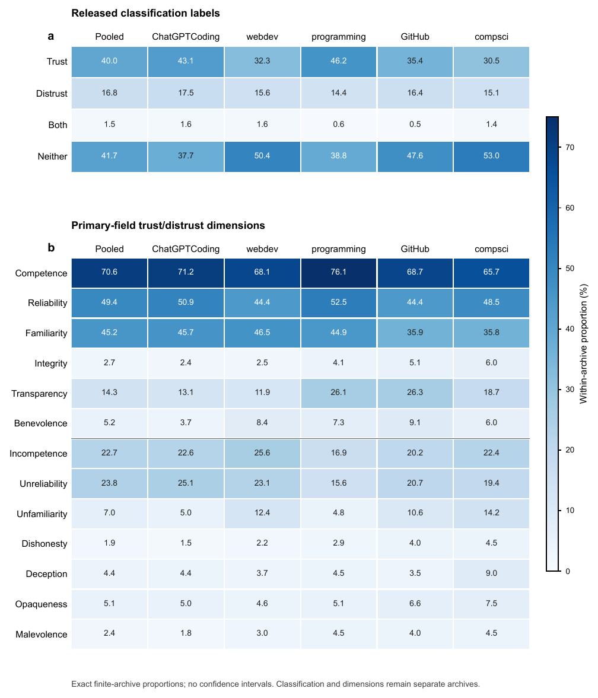

# Beyond the Aggregate: Trust and Distrust in Generative AI Across Technical Reddit Communities and Time

**Sole-author research · 2026**  
_Manuscript under review_

[](https://doi.org/10.5281/zenodo.23653961)
[](https://github.com/ivyhongzhan/genai-trust-reddit-analysis/actions/workflows/verify.yml)

**[Research Artifacts (Zenodo)](https://doi.org/10.5281/zenodo.23666151)** · [Research Figures](figures/) · [Results](results/) · [Reproduction Guide](reproduce.md)

## Overview

**How do aggregate measures of trust and distrust in generative AI relate to the community-specific and temporal patterns underlying them?**

This research examines computational classifications of trust and distrust across five technical Reddit communities through a descriptive secondary analysis of released research archives.

The study compares pooled summaries with community- and time-stratified descriptions while preserving the measurement, denominator, provenance, and availability boundaries of the underlying records.

Its central contribution is a context-preserving approach to reporting computational social-media measures: aggregate statistics become more interpretable when presented alongside the community and temporal distributions from which they are derived.

## Key Findings

**1. Aggregate patterns do not consistently represent individual communities.**

*Neither* is the most frequent classification in the pooled archive (41.7%). However, *Trust* is the most frequent classification in ChatGPTCoding (43.1%) and programming (46.2%).

**2. The released data capture multiple trust-related dimensions.**

Within the separate dimensions archive, Competence (70.6%), Reliability (49.4%), and Familiarity (45.2%) are the most frequently observed indicators. These measures can co-occur within individual records.

**3. Community and temporal stratification preserve information that pooled summaries cannot display.**

Distributions and data availability vary across sampled communities and half-year periods. Reporting these strata makes the composition and coverage of aggregate results explicit without attributing the observed differences to causal mechanisms.

This research contributes to a broader agenda on how trust in AI is measured and interpreted across social contexts.

## Research Visualizations



**Figure 1.** Pooled and community-specific distributions of released trust/distrust classifications and dimension indicators across five technical Reddit communities. The two panels use separate analytical archives and denominators.

[Full-resolution Figure 1 (PDF)](figures/rq1_figure.pdf) · [Temporal Classification Profiles](figures/classification_temporal_visualization.pdf) · [Temporal Dimension Profiles](figures/dimensions_temporal_visualization.pdf)

## Data and Methods

The study examines five technical Reddit communities:

`ChatGPTCoding` · `webdev` · `programming` · `GitHub` · `compsci`

| Analytical archive | Source records | Eligible records |
|---|---:|---:|
| Trust/distrust classifications | 8,520 | 8,519 |
| Trust/distrust dimensions | 4,964 | 4,964 |

**Analytical approach**

- Descriptive analysis of released computational classifications and dimension indicators.
- Separate analytical treatment of classification and dimensions archives.
- Community-level and UTC half-year stratification.
- Primary temporal comparison window: 2023-H1 to 2025-H1.
- Explicit accounting for missing values, denominator eligibility, measurement provenance, and sparse or unavailable observations.

The dimensions analysis uses a documented uniform-field replacement estimand because the publicly released material does not reproduce the source study's full mixed-field specification.

The analysis does not combine the two archives into a shared estimand or make causal, individual-level, or population-prevalence claims.

## Reproduction and Verification

The repository provides analysis scripts, frozen aggregate results, figures, provenance records, and automated verification tools.

### Quick Start

Clone the repository:

```bash
git clone https://github.com/ivyhongzhan/genai-trust-reddit-analysis.git
cd genai-trust-reddit-analysis
```

Verify the packaged artifacts:

```bash
python3 scripts/verify_package.py
```

Run the included tests:

```bash
python3 -m unittest discover -s tests -v
```

The verification script checks 12 frozen file hashes, selected reported statistics, and temporal reporting boundaries.

**Reproduction scope:** These commands verify distributed artifacts and numerical consistency. A complete raw-data-to-paper rerun was not established. An independent analysis from record-level data to the final manuscript requires additional inputs and processing steps not distributed here.

See the [Reproduction Guide](reproduce.md) for technical requirements and the documented scope of verification.

## Repository Structure

| Path | Description |
|---|---|
| [`scripts/`](scripts/) | Preserved analysis scripts and verification utilities |
| [`results/`](results/) | Frozen aggregate statistics and analytical tables |
| [`figures/`](figures/) | Research figures and temporal visualizations |
| [`provenance/`](provenance/) | Analysis decisions, freeze records, and research provenance |
| [`tests/`](tests/) | Automated verification tests |
| [`data/README.md`](data/README.md) | Data availability and source attribution |
| [`environment.yml`](environment.yml) | Recorded analysis environment |
| [`reproduce.md`](reproduce.md) | Reproduction instructions and boundaries |

## Archived Research Artifacts

The software and supporting research materials are archived on Zenodo.

**[Access Research Artifacts — Zenodo v3](https://doi.org/10.5281/zenodo.23666151)**

- **Version DOI:** [10.5281/zenodo.23666151](https://doi.org/10.5281/zenodo.23666151)
- **All-version DOI:** [10.5281/zenodo.23653961](https://doi.org/10.5281/zenodo.23653961)
- **Resource type:** Software
- **Access:** Open

The archived materials include research scripts, derived analytical outputs, figures, provenance documentation, and verification resources.

## Source Data and Attribution

This research is a secondary analysis of datasets released in connection with:

Pessianzadeh et al. (2026). *In Generative AI We (Dis)Trust? Computational Analysis of Trust and Distrust in Reddit Discussions*. *Transactions of the Association for Computational Linguistics*.

[Source Publication](https://doi.org/10.1162/TACL.a.744) · [Source Dataset](https://doi.org/10.5281/zenodo.20331918)

This secondary analysis has a different reporting and interpretation emphasis from the source study:

1. **Context-stratified reporting:** It presents pooled, community-specific, and UTC half-year-level descriptive distributions together, including explicit reporting of coverage and sparse or unavailable cells.
2. **Measurement transparency:** It documents separate archive denominators, record eligibility and exception rules, and the uniform-field replacement estimand used for the dimensions analysis. The replacement does not reconstruct or validate the source study's original mixed-field procedure.
3. **Interpretive scope:** It emphasizes context-preserving interpretation of released computational labels and dimensions, without treating sample-archive proportions as population-level measures of individuals' trust.

> 💡 **Note on Secondary Analysis & Data Ethics:**  
> This secondary analysis clarifies scope rather than claiming omissions by the source study. In compliance with data protection and platform terms, record-level Reddit-derived data are not redistributed here.

## Citation and Rights

To cite the research artifacts, use the [Zenodo archival record](https://doi.org/10.5281/zenodo.23666151) or the repository's [citation metadata](CITATION.cff).

**Original analysis and verification code:** [MIT License](LICENSE).

**Original documentation and author-created research figures:** [Creative Commons Attribution 4.0 International (CC BY 4.0)](LICENSE-CC-BY-4.0.md).

Third-party datasets and materials remain subject to their own terms. Derived result tables, provenance records, and other files not expressly covered by these grants are not automatically relicensed. For exact file coverage and attribution, see [License Scope](LICENSE-SCOPE.md).

Previously published [Zenodo v2](https://doi.org/10.5281/zenodo.23655847) and [Zenodo v3](https://doi.org/10.5281/zenodo.23666151) retain their separately recorded rights statements; the file-level grants in this repository do not retroactively modify those archived releases.

