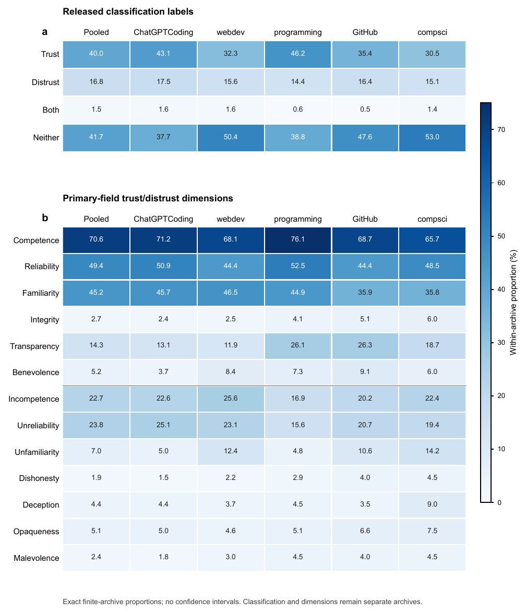

# Beyond the Aggregate: Trust and Distrust in Generative AI Across Technical Reddit Communities and Time

**Sole-author research · 2026**  
_Manuscript under review at PACM HCI (CSCW)_

[](https://doi.org/10.5281/zenodo.23653961)
[](https://github.com/ivyhongzhan/genai-trust-reddit-analysis/actions/workflows/verify.yml)

[SSRN Preprint](https://papers.ssrn.com/sol3/papers.cfm?abstract_id=7671698) · **[Research Artifacts (Zenodo)](https://doi.org/10.5281/zenodo.23666151)** · [Research Figures](figures/) · [Results](results/) · **[Public Reproduction Guide](docs/PUBLIC_REPRODUCTION.md)**

## Overview

**How do pooled classifications of trust and distrust in generative AI compare with patterns within individual Reddit communities and half-year periods?**

I conducted a descriptive secondary analysis of data released by Pessianzadeh et al. (2026). I compared pooled summaries with community and half-year distributions, keeping the classification and dimensions archives separate.

## Key Findings

- **The pooled leading label does not lead in every community.** *Neither* accounts for 41.7% of pooled classifications, while *Trust* leads in ChatGPTCoding (43.1%) and programming (46.2%).
- **Several dimension indicators occur frequently.** In the separate dimensions archive, Competence appears in 70.6% of records, Reliability in 49.4%, and Familiarity in 45.2%. These indicators can co-occur within a record.
- **Community and time views reveal differences in composition and coverage.** Pooled summaries alone do not show these distributions or sparse and unavailable half-years.

The findings support reporting pooled AI-trust discourse summaries alongside community and temporal views, with their measurement fields, denominators, data sources, and coverage limits.

## Research Visualizations



**Figure 1.** Pooled and community-specific distributions of released trust/distrust classifications and dimension indicators across five technical Reddit communities. The two panels use separate analytical archives and denominators.

**[High-resolution Figure 1 (320 dpi PDF)](figures/rq1_figure_300dpi.pdf)** · [Historical frozen Figure 1 (PDF)](figures/rq1_figure.pdf) · [Temporal Classification Profiles](figures/classification_temporal_visualization.pdf) · [Temporal Dimension Profiles](figures/dimensions_temporal_visualization.pdf)

## Data and Methods

The study examines five technical Reddit communities:

`ChatGPTCoding` · `webdev` · `programming` · `GitHub` · `compsci`

| Analytical archive | Source records | Eligible records |
|---|---:|---:|
| Trust/distrust classifications | 8,520 | 8,519 |
| Trust/distrust dimensions | 4,964 | 4,964 |

**Analytical approach**

- Descriptive analysis of released computational classifications and dimension indicators.
- Separate analytical treatment of classification and dimensions archives.
- Community-level and UTC half-year stratification.
- Primary temporal comparison window: 2023-H1 to 2025-H1.
- Explicit accounting for missing values, denominator eligibility, measurement provenance, and sparse or unavailable observations.

The dimensions analysis uses the same released model-output field for every dimension: `Output_gpt-4.1-2025-04-14_few`. This documented replacement estimand differs from the source study's mixed-field specification, which could not be reconstructed from the public release.

The analysis does not combine the two archives into a shared estimand or make causal, individual-level, or population-prevalence claims.

## Reproduction and Verification

The repository provides analysis scripts, frozen aggregate results, figures, provenance records, and automated verification tools.

### Quick Start

Clone the repository:

```bash
git clone https://github.com/ivyhongzhan/genai-trust-reddit-analysis.git
cd genai-trust-reddit-analysis
```

Verify the packaged artifacts:

```bash
python3 scripts/verify_package.py
```

Run the included tests:

```bash
python3 -m unittest discover -s tests -v
```

The verification script checks 12 frozen file hashes, selected reported statistics, and temporal reporting boundaries.

The quick checks above verify packaged files and selected statistics; they do not run record-level analysis.

The [public workflow](docs/PUBLIC_REPRODUCTION.md) rebuilds the main numerical results and three principal figure layouts from the two public source ZIPs. A documented clean-checkout run passed **68 specified checks**. See the [dated acceptance audit](docs/PUBLIC_REPRODUCTION_AUDIT_20261105.md) for the executed environment and results.

A complete raw-data-to-paper rerun was not established. The workflow does not reproduce the complete manuscript or identify the exact uploaded submission PDF. The historical Day 17 gate remains **BLOCKED**, and the original Day 24 supporting-figure code remains unavailable. Historical frozen figures are unchanged; a separate [Figure 1 export with approximately 320 dpi embedded images](figures/rq1_figure_300dpi.pdf) is available.

See [reproduce.md](reproduce.md) for additional workflows and release-package details.

## Repository Structure

| Path | Description |
|---|---|
| [`scripts/`](scripts/) | Preserved analysis scripts and verification utilities |
| [`results/`](results/) | Frozen aggregate statistics and analytical tables |
| [`figures/`](figures/) | Research figures and temporal visualizations |
| [`provenance/`](provenance/) | Analysis decisions, freeze records, and research provenance |
| [`tests/`](tests/) | Automated verification tests |
| [`data/README.md`](data/README.md) | Data availability and source attribution |
| [`environment.yml`](environment.yml) | Recorded analysis environment |
| [`reproduce.md`](reproduce.md) | Reproduction instructions and boundaries |

## Archived Research Artifacts

The software and supporting research materials are archived on Zenodo.

**[Access Research Artifacts — Zenodo v3](https://doi.org/10.5281/zenodo.23666151)**

- **Version DOI:** [10.5281/zenodo.23666151](https://doi.org/10.5281/zenodo.23666151)
- **All-version DOI:** [10.5281/zenodo.23653961](https://doi.org/10.5281/zenodo.23653961)
- **Resource type:** Software
- **Access:** Open

The archived materials include research scripts, derived analytical outputs, figures, provenance documentation, and verification resources.

## Source Data and Attribution

This research is a secondary analysis of datasets released in connection with:

Pessianzadeh et al. (2026). *In Generative AI We (Dis)Trust? Computational Analysis of Trust and Distrust in Reddit Discussions*. *Transactions of the Association for Computational Linguistics*.

[Source Publication](https://doi.org/10.1162/TACL.a.744) · [Source Dataset](https://doi.org/10.5281/zenodo.20331918)

This analysis compares pooled, community, and half-year distributions while documenting separate archive denominators, eligibility rules, and the replacement dimension field. It does not reconstruct or validate the source study's mixed-field procedure. The proportions describe released discourse records, not population-level measures of individuals' trust.

Record-level Reddit-derived data are not redistributed here.

## Citation and Rights

To cite the research artifacts, use the [Zenodo archival record](https://doi.org/10.5281/zenodo.23666151) or the repository's [citation metadata](CITATION.cff).

**Original analysis and verification code:** [MIT License](LICENSE).

**Original documentation and author-created research figures:** [Creative Commons Attribution 4.0 International (CC BY 4.0)](LICENSE-CC-BY-4.0.md).

Third-party datasets and materials remain subject to their own terms. Derived result tables, provenance records, and other files not expressly covered by these grants are not automatically relicensed. For exact file coverage and attribution, see [License Scope](LICENSE-SCOPE.md).

Previously published [Zenodo v2](https://doi.org/10.5281/zenodo.23655847) and [Zenodo v3](https://doi.org/10.5281/zenodo.23666151) retain their separately recorded rights statements; the file-level grants in this repository do not retroactively modify those archived releases.

